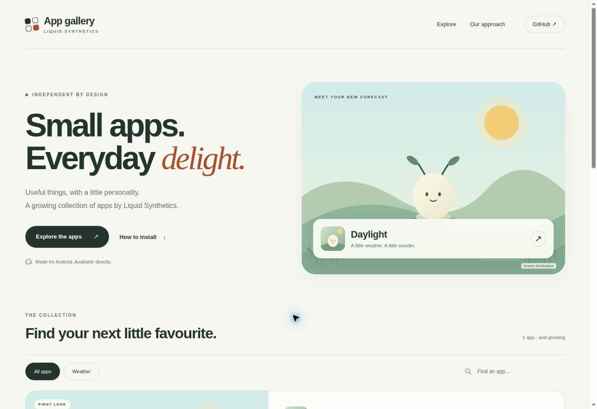

# App Gallery

Independent Android apps by Liquid Synthetics. Public showcase for **mail-brandonai/app-gallery**, designed for GitHub Pages at `https://mail-brandonai.github.io/app-gallery/` once Pages is enabled.



## Local development

Node 22+, no install or dependencies required:

```sh
npm test
npm run build
# Serve dist/ with your preferred static server.
```

`site/` contains the complete static site, images and app catalog. `scripts/build.mjs` copies it to `dist/`. All URLs are relative, including the JSON catalog, so project-path hosting works. The initial gallery has Daylight; scene artwork is explicitly labelled as illustration, not a device screenshot. No analytics, external fonts, account system or browser-side authenticated GitHub requests.

The deployment workflow builds, tests and publishes on main changes and manual dispatch. Release changes queue a workflow dispatch on main, so deployment does not require allowing release tags through the github-pages environment rules. **One-time setup:** Repository Settings → Pages → Build and deployment → Source → GitHub Actions. Then run **Publish gallery**. The connector used to prepare this repo cannot change Pages settings.

## App entries

`site/data/apps.json` holds app metadata. The current Daylight detail page is authored in HTML; new apps need corresponding detail markup and routing as well as a catalog entry. Shared styles, filtering, artwork hosting, release discovery and installation guidance are reusable. Do not add fictional apps, testimonials, download counts, or device screenshots.

## APK publishing

App source can remain private. This public repository contains the website and published release binaries, not private source or signing material.

1. Build and verify a **release-signed APK**, maintaining the same permanent signing certificate and increasing the Android version code for updates. Keep keystores and passwords outside this repository.
2. Name the artifact `daylight.apk` and create its SHA-256 file:

```sh
shasum -a 256 daylight.apk > daylight.apk.sha256
```

3. Publish a release with the app-specific prefix, e.g. `daylight-v0.1.0`:

```sh
gh release create daylight-v0.1.0 daylight.apk daylight.apk.sha256 \
  --repo mail-brandonai/app-gallery \
  --title 'Daylight 0.1.0' --notes-file release-notes.md
```

The build discovers public, non-draft, non-prerelease releases with each app's `releasePrefix`, selects the most recently published eligible APK, and writes its versioned URL, size and GitHub-provided SHA-256 digest into the deployed catalog. It never uses the repository-global `/releases/latest` link for a multi-app gallery. A published release without a matching uploaded APK does not enable downloads. Removing all eligible releases clears download metadata on the next deployment. APK content/signature must be verified before publication; release discovery does not itself certify signing.

Local builds use the checked-in catalog without remote discovery. CI fetches release metadata with its repository-scoped read token at build time; no token appears in the website. GitHub API errors fail a deployment rather than advertising stale release metadata. Publishing via another workflow's `GITHUB_TOKEN` does not trigger a release workflow automatically; explicitly dispatch the gallery workflow or use a properly scoped GitHub App token for that future integration.

Daylight has **no signed public APK release yet**, so its download control currently explains that the release is in preparation. No debug APK is advertised as a production build.

Website images are optimized SVG illustrations and WebP artwork served by Pages. `scripts/create-art.py` reproduces them without external dependencies. Real screenshots can replace the illustrations when captured from a release build, with the labels updated to match.

## Ascent

The catalog now also contains Ascent, the local AI workspace. Its public release tag prefix is `ascent-v` and its APK asset must be named `ascent.apk`. The Ascent repository signs the APK using its own signing secrets, publishes a private backup, and uploads the public release here using `APP_GALLERY_RELEASE_TOKEN`. The existing release event workflow redeploys Pages from main. Until that verified release exists, Ascent's detail page shows the preparation state without a download link. Daylight retains its independent tags and download.

## Progressive web app

The Gallery is installable on supported browsers, with a standalone window, its own Gallery icons and an Apple home-screen icon. The manifest and worker use relative URLs, so the same build works at the custom-domain root or the GitHub Pages repository path. No hosting migration or server is required.

The browser’s install prompt appears only after the user clicks **Install App Gallery**, when the browser supplies that capability. Manual browser-menu and Safari instructions are available under **Install Gallery**. Installation does not install the Android apps, request notifications, or add any account/telemetry service.

The service worker precaches the Gallery document, scripts, styles, manifest and artwork. It never intercepts/caches APKs, external URLs, release metadata or unknown files. The catalog remains network-only; unavailable/offline releases disable downloads and explicitly ask users to reconnect. Reconnection and returning to a visible tab recheck release availability. Previously opened shell content is available offline after the first successful connected visit; downloads require a connection. Browsers may evict offline storage.

`npm run build` hashes all shell inputs, versions script/style URLs and generates the worker’s immutable cache and precache list. New workers download the complete new shell before offering **Update Gallery**; accepting activates it and reloads controlled tabs. Old Gallery caches are removed after activation. Release-only deployments update network metadata without forcing a shell update. Refreshing a visible tab also checks for an updated worker.

Validation: `npm test` covers manifest/icon dimensions, root and repository-path worker scope, offline navigation and assets, exclusion of catalog/APKs, and cache activation/update behavior. Real home-screen installation should also be checked on Android Chrome and iOS Safari; browser installation support differs.

## Zooom!

Zooom! is an offline Flutter/Flame creature arena with Snake, Eel and Millipede characters, saved collections, local records and built-in bots. Its independent release prefix is `zooom-v`, with the signed download named `zooom.apk`. Android 8.0+ and ARM64 or x86-64 are required. The source repository signs its successfully checked release build using its own keystore secrets and publishes with `APP_GALLERY_RELEASE_TOKEN`.

The Games card and detail page use the actual bundled racing illustration, optimized to WebP, and an SVG adaptation of the Android launcher vector. Artwork is labelled as illustration, not a gameplay screenshot. Original art provenance remains documented in the private source repository. Gallery download discovery, checksums, offline browsing and update behavior apply independently to Zooom!, Daylight and Ascent. Filters and in-page routing use each app's metadata rather than a two-app fallback.

## Mozart

Mozart is an offline native Android music studio with a tablet-first arrangement/editor workspace, original instrument families, a twelve-pad kit, piano-roll editing, Live performance, track automation, mixer effects and WAV/MIDI/stem/project export. It uses the independent `mozart-v` release prefix and a verified signed asset named `mozart.apk`. Android 8.0+ and ARM64 or x86-64 are required. The source repository owns its signing identity and publishes with `APP_GALLERY_RELEASE_TOKEN`.

The Gallery uses Mozart's original vector launcher master and an explicitly labelled vector studio illustration, not an invented device screenshot. Downloads, checksums and offline behavior are discovered independently from the other apps.
